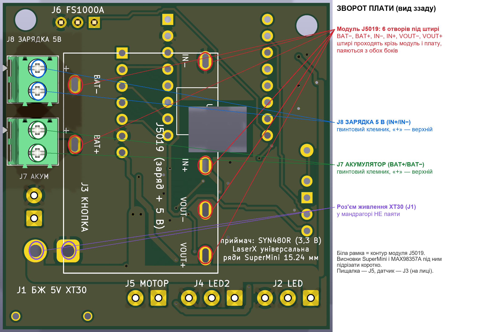

# Плата шапки (50 × 50 мм)

Плата під ESP32-C3 SuperMini — та сама, що в щитах LaserX «6-7», варіант `hat`: плюс ключ мотора «рота»,
а на звороті — місце під модуль заряду J5019 для мандрагори (від акумулятора).

| Файл | Що це |
|---|---|
| `shield67-hat-gerber.zip` | **для замовлення** (JLCPCB, PCBWay…): завантажити zip як є, 2 шари, 1,6 мм |
| `gerber-hat/` | ті самі гербери й свердління, розпаковані |
| `BOM-hat.csv` | список деталей |
| `shield67-hat-schematic.pdf` | принципова схема |
| `render-top-hat.png`, `render-bottom-hat.png`, `routing-hat.png` | як виглядає плата і доріжки |
| `shield67-hat.kicad_*`, `lib/`, `*-lib-table` | проєкт KiCad 10 (відкривати `shield67-hat.kicad_pro`) |

## Замовлення: панель 2×2 = 4 плати на 100×100 мм
Мінімальне замовлення 5 шт. → 5 панелей = **20 плат** — на всі атракціони (шапка, щити тощо: та сама плата, різні деталі розпаюються).

| Файл | Що це |
|---|---|
| `panel-hat-gerber.zip` | **для замовлення панеллю** |
| `gerber-panel-hat/`, `panel-hat.kicad_pcb` | те саме розпаковане / KiCad |
| `render-top-panel-hat.png` | як виглядає панель |

Як замовляти на JLCPCB: завантажити `panel-hat-gerber.zip`, розмір визначиться **100 × 100 мм**, далі
**Delivery Format / Panel: «Panel by Customer»**, **Panel Format: V-cut** (лінії V-cut — посередині по x і y, у шарі контуру),
кількість **5**. Шари 2, товщина 1,6 мм, решта — за замовчуванням.
Мідь від лінії V-cut — 0,5 мм (вимога JLCPCB ≥ 0,4). Плати ламаються руками по V-cut, потім паяються.

Під щит «6-7» мотор не потрібен: Q1, R7, R8, D2, C5, J5 не паяти. На шапці й щитах U6, J7, J8 (зворот) не паяти.

## Роз'єми
| | Що підключати |
|---|---|
| **J1** XT30PW-M | блок живлення **5 В** (на дроті — XT30U-F). Захисту від переполюсовки немає |
| **J2** | стрічка WS2812B (GPIO10) |
| **J3** | кнопка на шапці (GPIO5 → GND) |
| **J4** | друга стрічка (GPIO7), необов'язково |
| **J5 МОТОР** | M+ = +5 В, M− = ключ Q1 AO3400A (GPIO20), діод SS34 паралельно мотору |
| **J6** | передавач FS1000A (TX = GPIO21, 5V, GND), на майбутнє |
| **J7** АКУМ (зворот) | лише мандрагора: акумулятор Li-ion 3,7 В, «+» — верхній вивід; вимикач — у дроті «+» |
| **J8** ЗАРЯДКА 5 В (зворот) | лише мандрагора: гніздо зарядки 5 В (на стінці відра) → IN+/IN− модуля, «+» — верхній |
| динамік | у клеми модуля MAX98357A |

Приймач — SYN480R 433 МГц, антена — дріт 17,3 см у пад **ANT**. Отворів кріплення 2 (угорі).

## Мандрагора: живлення від акумулятора

- **U6 — модуль J5019** (заряд Li-ion + підвищувач до 5 В) на **звороті**, на штирях 2,54 мм крізь 6 отворів:
  BAT−, BAT+, IN−, IN+, VOUT−, VOUT+. Отвори овальні (допуск ±0,6 мм). Відстані між отворами (виміряв замовник):
  BAT−↔BAT+ 9,2 мм, VOUT−↔VOUT+ 7,0, IN−↔IN+ 16, IN+↔VOUT− 6,8, BAT+↔VOUT− уздовж 10, ряди 20.
- Перед пайкою **роздрукувати `mandrake-back-1to1.pdf` у масштабі 100 %** і прикласти модуль: отвори мають збігтися.
- Висновки SuperMini і MAX98357A під модулем підрізати коротко; штирі модуля, що виходять на лице під модулі, — теж.
- Підвищувач J5019 **до пайки виставити на 5,0 В** (підстроювач на модулі, тестером на VOUT).
- **XT30 (J1) у мандрагорі не паяти**: це вхід 5 В на рейку плати, а не зарядка. Зарядка — тільки через **J8**.
- Пищалка (активна, 5 В) — на **J5** (M+ / M−), датчик (геркон / Холл / мікроперемикач) — на **J3**.

## Як паяти
1. Спершу SMD: U4, U5 (ключ — вивід 1), Q1, R1–R8, C2–C6, D1 і D2 (**смужка — катод**), C1.
   **C1** — SMD-електроліт 1000 мкФ 10 В, 10×10,5 мм (Hitano ELV102M10RF): **чорна мітка на корпусі — мінус, праворуч**, зрізані кути основи — до «+» ліворуч.
2. Гребінки «мама»: 2 × 1×8 (SuperMini), 1×7 (MAX98357A), 1×4 (SYN480R) — вставити в модулі й паяти разом із ними.
3. Клемники, XT30 (у мандрагорі — замість XT30 модуль J5019 і клемники J7, J8 на звороті).
4. Тестером: +5V ↔ GND немає КЗ; на 5V SuperMini після D1 ≈ 4,7 В від блока.

## Звідки файли
Плату генерує скрипт у репозиторії [challenge-duel](https://github.com/PetroBosak/challenge-duel/tree/claude/relaxed-gauss-k7b976/pcb)
(`SHIELD67_VARIANT=hat python pcb/tools/build.py --export`). Правки — там, потім скопіювати сюди файли `*-hat*`.
